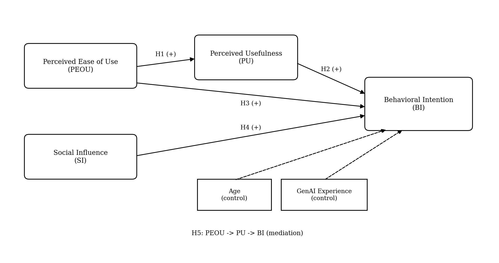
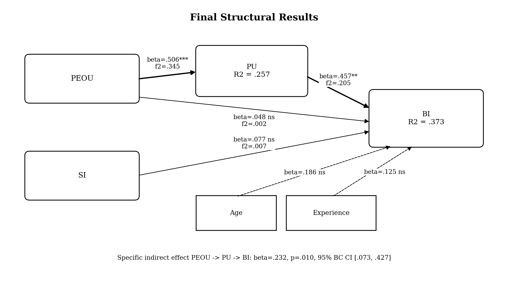

# Generative AI Adoption Among University Students: A PLS-SEM Study

**R | SmartPLS | PLS-SEM | Technology Acceptance Model | UTAUT2 | Mediation | Predictive Analysis**

This project examines why university students intend to continue using generative AI tools for academic tasks. The model combines core ideas from the **Technology Acceptance Model (TAM)** with **Social Influence** from UTAUT2 and tests both direct effects and mediation using Partial Least Squares Structural Equation Modeling (PLS-SEM).

The study was developed as an applied graduate research project in Information Systems at the University of Nevada, Reno.

## Research question

> How do perceived ease of use, perceived usefulness, and social influence shape university students' behavioral intention to use generative AI for academic tasks, and does perceived usefulness mediate the effect of perceived ease of use on behavioral intention?

## Conceptual model

The study includes four reflective latent constructs:

- **PEOU** — Perceived Ease of Use
- **PU** — Perceived Usefulness
- **SI** — Social Influence
- **BI** — Behavioral Intention

Age and prior GenAI experience were included as manifest control variables predicting BI.



### Hypotheses

- **H1:** PEOU positively influences PU.
- **H2:** PU positively influences BI.
- **H3:** PEOU positively influences BI.
- **H4:** SI positively influences BI.
- **H5:** PU mediates the relationship between PEOU and BI.

## Data and survey design

The survey was built in **Qualtrics** and used adapted measures from established technology-acceptance research.

- PEOU and PU items were adapted from **Davis (1989)**.
- BI items were adapted from TAM-related behavioral-intention measures, including **Davis, Bagozzi, and Warshaw (1989)**.
- SI items were adapted from **UTAUT2** (**Venkatesh, Thong, & Xu, 2012**).
- All latent-construct items used a **7-point Likert scale** from *Strongly disagree* to *Strongly agree*.

The survey produced **83 recorded responses**. Data-quality screening removed preview/test records, non-consenting responses, ineligible respondents, and failed attention checks, leaving a final analytic sample of **N = 63**.

### Data screening

| Step | Cases |
|---|---:|
| Raw Qualtrics responses | 83 |
| Preview/test records removed | 3 |
| Non-consent removed | 1 |
| Ineligible respondents removed | 9 |
| Failed attention checks removed | 7 |
| **Final analytic sample** | **63** |

No retained cases had missing values on the variables used in the PLS-SEM model.

> **Privacy note:** Respondent-level survey data are intentionally not published in this repository. The repository contains the analysis workflow, aggregate results, figures, tables, and report only.

## Methodology

The model was estimated using **PLS-SEM** with the standard path-weighting approach. The analysis followed the usual two-stage process:

1. **Measurement model assessment**
   - Outer loadings
   - Cronbach's alpha
   - rho_A
   - Composite reliability
   - Average variance extracted (AVE)
   - HTMT
   - Fornell-Larcker criterion
   - Cross-loadings

2. **Structural model assessment**
   - Inner VIF
   - Path coefficients
   - 5,000-sample bootstrapping
   - R² and adjusted R²
   - f² effect sizes
   - Mediation analysis
   - PLSpredict / out-of-sample prediction

SmartPLS was the primary source for measurement and structural results. R was used to supplement the analysis with predictive assessment when PLSpredict was not available in the local SmartPLS interface.

## Key findings



### Structural paths

| Hypothesis | Relationship | β | t | p | f² | Decision |
|---|---|---:|---:|---:|---:|---|
| H1 | PEOU → PU | 0.506 | 4.538 | < .001 | 0.345 | Supported |
| H2 | PU → BI | 0.457 | 3.072 | .002 | 0.205 | Supported |
| H3 | PEOU → BI | 0.048 | 0.342 | .732 | 0.002 | Not supported |
| H4 | SI → BI | 0.077 | 0.580 | .562 | 0.007 | Not supported |

The strongest substantive pattern is that **ease of use increases perceived usefulness, and perceived usefulness then increases behavioral intention**. Ease of use does not have a meaningful direct effect on intention once usefulness is included.

### Mediation

The indirect effect **PEOU → PU → BI** was significant:

- **β = 0.232**
- **t = 2.584**
- **p = .010**
- **95% bias-corrected CI [0.073, 0.427]**

Because the direct PEOU → BI path was not significant, the result is classified as **indirect-only mediation**. In practical terms, ease of use matters mainly because it helps students perceive GenAI as useful.

### Explanatory power

- **PU:** R² = 0.257, adjusted R² = 0.244
- **BI:** R² = 0.373, adjusted R² = 0.318

The model therefore explains **25.7% of the variance in perceived usefulness** and **37.3% of the variance in behavioral intention**.

### Predictive performance

The out-of-sample prediction analysis showed:

- PLS produced **lower RMSE than the linear-model benchmark for all 7 predicted indicators**.
- PLS produced **lower MAE than the linear-model benchmark for all 7 predicted indicators**.
- Q²predict was positive for **6 of 7 indicators**.

This indicates generally strong out-of-sample predictive performance, with one behavioral-intention indicator showing weaker predictive relevance.

## Measurement quality

The measurement model met the main reliability and validity criteria.

| Construct | Cronbach's α | rho_A | Composite Reliability | AVE |
|---|---:|---:|---:|---:|
| PEOU | 0.798 | 0.842 | 0.866 | 0.621 |
| PU | 0.829 | 0.851 | 0.885 | 0.659 |
| SI | 0.923 | 0.949 | 0.951 | 0.865 |
| BI | 0.914 | 0.960 | 0.945 | 0.852 |

All substantive HTMT values were below 0.85. One indicator, **PEOU1 (loading = 0.630)**, was retained because construct reliability and AVE remained satisfactory and deleting it was not theoretically justified.

## Repository structure

```text
genai-adoption-pls-sem/
├── README.md
├── .gitignore
├── analysis/
│   ├── README.md
│   └── pls_sem_analysis.R
├── data/
│   └── README.md
├── docs/
│   ├── codebook.md
│   └── survey_instrument.md
├── report/
│   └── GenAI_Adoption_Manuscript.pdf
└── results/
    ├── README.md
    ├── GenAI_PUBLICATION_TABLES.xlsx
    ├── figures/
    │   ├── proposed_structural_model.png
    │   └── final_structural_results.png
    └── tables/
        ├── data_screening.csv
        ├── measurement_model.csv
        ├── structural_model.csv
        └── mediation.csv
```

## Reproducing the analysis

The R script in [`analysis/pls_sem_analysis.R`](analysis/pls_sem_analysis.R) documents the model specification and the main SEM workflow. Because respondent-level data are not published, the script expects a local file named:

```text
data/GenAI_FINAL_SmartPLS_Ready.csv
```

The expected variables are:

```text
PEOU1 PEOU2 PEOU3 PEOU4
PU1 PU2 PU3 PU4
SI1 SI2 SI3
BI1 BI2 BI3
AGE EXP
```

The public repository is therefore **methodologically transparent but privacy-preserving**.

## Main files

- [Final research manuscript](report/GenAI_Adoption_Manuscript.pdf)
- [Publication-ready result tables](results/GenAI_PUBLICATION_TABLES.xlsx)
- [R analysis workflow](analysis/pls_sem_analysis.R)
- [Survey instrument](docs/survey_instrument.md)
- [Variable codebook](docs/codebook.md)

## Limitations

- The final sample is relatively small and was collected using a nonprobability convenience approach.
- The study is cross-sectional, so the relationships should not be interpreted as definitive causal effects.
- All main constructs were measured using self-reported survey responses.
- Several indicators showed non-normal distributions, although PLS-SEM is relatively robust to non-normal data.
- Social influence did not significantly predict intention in this sample, which may reflect the academic GenAI context or characteristics of the respondents.

## References

- Davis, F. D. (1989). Perceived usefulness, perceived ease of use, and user acceptance of information technology. *MIS Quarterly, 13*(3), 319–340.
- Davis, F. D., Bagozzi, R. P., & Warshaw, P. R. (1989). User acceptance of computer technology: A comparison of two theoretical models. *Management Science, 35*(8), 982–1003.
- Venkatesh, V., Thong, J. Y. L., & Xu, X. (2012). Consumer acceptance and use of information technology: Extending the unified theory of acceptance and use of technology. *MIS Quarterly, 36*(1), 157–178.

## Author

**Mithoon Chakraborty**  
M.S. in Information Systems  
University of Nevada, Reno
